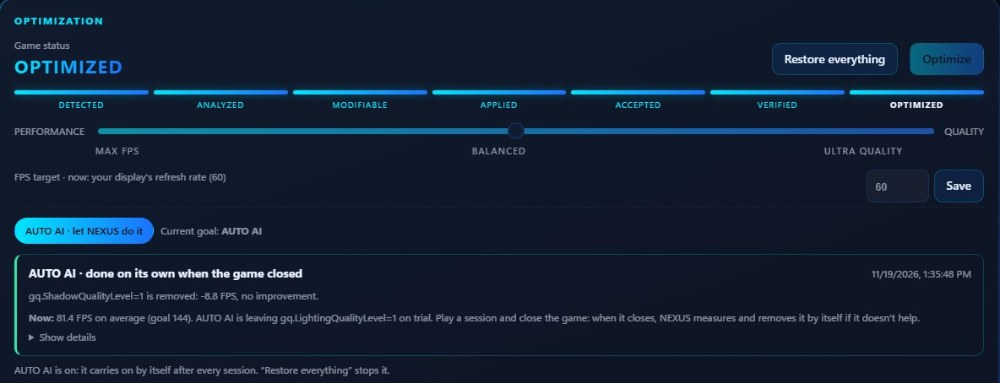
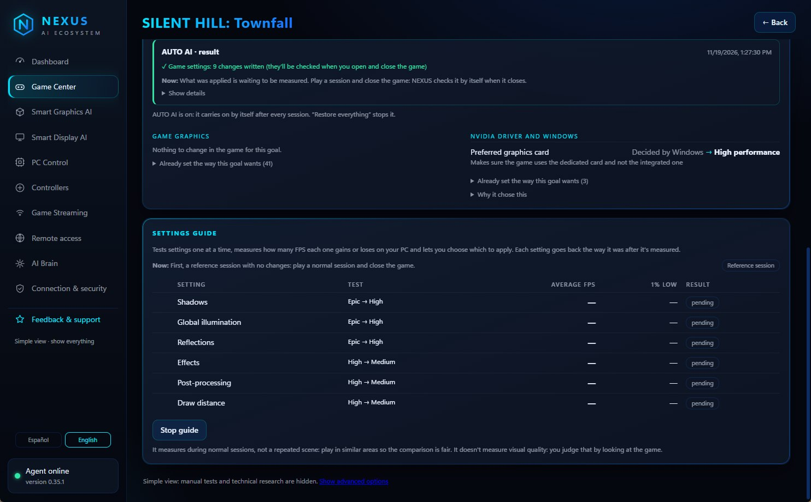
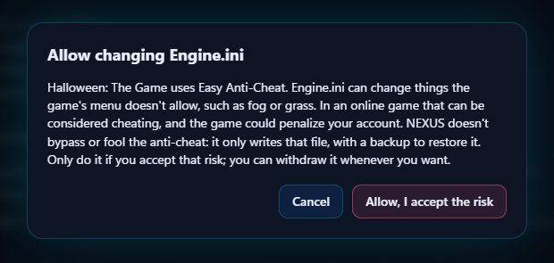

# NEXUS AI Ecosystem — beta

**English** · [Español ↓](#español)

NEXUS is a free Windows app (in beta) that tunes your games' graphics **by measuring, not guessing**. It changes one thing, watches your real FPS while you play, and keeps only what actually helps on your PC.

> **This is a beta.** It has been tested on very few PCs and it may fail. Everything it changes can be undone with one button.

The app is in **English and Spanish**. It uses your Windows language the first time, and you can switch it at any moment from the menu.

**Current version: [0.39.0](https://github.com/Haitianleo/nexus-beta/releases/tag/v0.39.0-beta)**

## What's new in 0.39

- **Update from the app.** NEXUS shows the new version's notes and offers *Update now*, *Later* or *Skip this version*. It only installs if the SHA-256 hash matches the published one, then reopens by itself.
- **Windows notifications with buttons:** new version, newly installed game, dangerous temperature while playing, and AUTO AI only when it really raised your FPS (measured). Each kind can be turned off.
- **Settings saved in `.sav` files.** Some Unreal games keep their graphics options in their own save file and ignore their `.ini`. NEXUS now writes those too, with a backup, only with the game closed, and checks them after you play. Encrypted or unknown files are marked *Not recognized* and left alone.
- **More accurate FPS:** standard *1% low* from each frame's time, and FPS from the game itself, not other windows.
- **New dark installer**, in English or Spanish depending on Windows.
- **Anonymous statistics**, on by default with a notice on first launch (see *Privacy*).
- **Game Streaming and Remote access** show as *Coming soon*: in this beta NEXUS works on this PC only.

## How it works

1. **Press AUTO AI on a game.** NEXUS reads the game's settings files and applies what it can change safely: the game's own settings, the NVIDIA driver profile and the Windows graphics preference. It saves how everything was first.
2. **Play normally, then close the game.** While you play, NEXUS records FPS with [PresentMon](https://github.com/GameTechDev/PresentMon) (Intel's open-source frame counter), plus GPU load, VRAM and temperatures.
3. **NEXUS compares and decides.** After the session it compares FPS before and after. A change that didn't help is removed. If your FPS still don't reach the target, it leaves **one** new option on trial for your next session. You get a Windows notification each time.
4. **Undo at any time.** **Restore everything** puts every setting back the way it was.

It never promises FPS: it tells you what it measured, also when a change did nothing. What it cannot measure is shown as "—".

### Your FPS target

By default AUTO AI aims at your display's refresh rate. You can type your own number for each game (for example 90), or move the slider to **MAX FPS** (keeps looking for more FPS) or **ULTRA QUALITY** (never lowers quality).

## Settings guide (new in 0.35)

Suggested by a Reddit user: like the "optimized settings" guides from hardware channels, but measured on **your** PC.

- First, one reference session with no changes. Then **one setting per session**: shadows, global illumination, reflections, effects, post-processing and draw distance, each one level lower.
- For each setting you see the FPS gained or lost, the 1% low, and a verdict: *clear gain*, *lowers FPS*, *no measurable effect* or *unclear*. If it's unclear, the same test runs one more session.
- Each setting goes back the way it was after it's measured. At the end you tick the ones that are worth it to you, and NEXUS applies only those.
- If the game puts its settings file back (some games do), the guide notices on the first test and carries on through Engine.ini, which the game reads at startup (new in 0.36.1).
- **Plan B (new in 0.37):** when the guide works through Engine.ini, it also writes the exact variables the game itself uses for that level, read from the game's own configuration inside its packages (only when they aren't encrypted). That way the level applies even if the game re-applies its quality groups at startup, and the values are the game's own, not made up. The table shows it as "via Engine.ini · N variables from the game".
- **Forget what was learned (new in 0.37):** to run the guide again from scratch, this button sets aside what NEXUS checked about that game on your PC. It doesn't change the game or undo anything you applied.

Its limits, plainly: it takes several sessions; it measures normal play, not a repeated benchmark scene, so it is noisier than a benchmark (play in similar areas); and it doesn't judge image quality, which you decide by looking at the game. It passes automated tests but hasn't been tried with real play sessions yet. The screenshot shows it at the start.

## Keep a setting as it is (new in 0.36)

Asked on Reddit: "I want ray tracing on and let it tune the rest." Each game now has **What NEXUS leaves alone in this game**: one button per kind of setting (ray tracing, shadows, textures…). AUTO AI, Optimize and the settings guide leave those alone. If NEXUS had already changed one, it puts it back, unless you changed it yourself in the game menu afterwards.

Since 0.37, when AUTO AI changes something it reminds you right there: if something looks worse (say, blurrier shadows), tick it in **What NEXUS leaves alone** and it goes back.

It passes automated tests but hasn't been tried in real play sessions yet.

## Your own Engine.ini changes are kept (new in 0.37)

Engine.ini isn't only NEXUS's: you can edit it yourself, and some games (Mortal Shell II, for example) save their own options there. Before, undoing a NEXUS change put the whole file back to its old copy, which could also undo your changes or the game's. Now NEXUS removes only its own lines; if nobody else touched the file, it goes back exactly as it was. The note NEXUS writes in that file is now in English.

## More kinds of settings recognized (new in 0.37)

NEXUS now tells apart 25 kinds of graphics settings instead of 21, in any game that saves them in readable files. Frame generation, geometry and detail, materials and hair are new, and it recognizes more names for HDR (including Unreal's standard HDR setting, which it missed in every game), low latency, lighting, FPS limit, effects (film grain, sharpening…) and display. Checked against the real settings files of three games.

## Games with anti-cheat

A common question is whether an anti-cheat will pick NEXUS up.

- NEXUS doesn't inject anything into games, doesn't read or write game memory, and never modifies executables, game data packages or anti-cheat files. FPS come from PresentMon, which reads Windows' own event tracing: no hooks, no overlay.
- When it detects an anti-cheat in a game (Easy Anti-Cheat, BattlEye, NCGuard, nProtect GameGuard, XIGNCODE3, EA Anti-Cheat and others), by default it only changes the NVIDIA driver profile and the Windows graphics preference. Those work outside the game, like the NVIDIA Control Panel.
- For each game you can give it **two separate permissions**, both off by default:
  1. **Its settings file**: the same file the game's own graphics menu writes. It's like changing the menu yourself.
  2. **Engine.ini**: it can change things the menu doesn't offer, like fog. In an online game that may be seen as cheating, so NEXUS shows a warning first and the choice is yours. Withdrawing the permission puts Engine.ini back the way it was.
- Detection looks for the anti-cheat's files in the game folder. An anti-cheat installed only as a system driver can't be seen that way. I can't test every anti-cheat: in competitive online games, leave both permissions off.

**Settings saves (`.sav`) count as the game's settings file:** in a game with anti-cheat, NEXUS only writes them with that game's extended permission, never saved games.

**Extended permissions are your responsibility.** NEXUS takes no responsibility for penalties or bans if you turn them on. Removing them puts back what was changed with them.

## What it does not do

- It does not modify game executables or data packages.
- It does not touch, disable or bypass anti-cheat systems.
- It does not decrypt protected files. If a game encrypts its settings, NEXUS says so and uses other routes.
- It does not make numbers up.

## Also inside

A live PC dashboard (temperatures, load, fans, FPS), your Steam and Epic library, and power controls.

## Updating from the app (new in 0.39)

Once a day NEXUS checks this page for a newer version. If there is one, it shows the notes and offers **Update now**, **Later** (asks again the next day) or **Skip this version**. *Update now* downloads the installer only from this page's releases and checks its SHA-256 against the published `.sha256` file; if it doesn't match, nothing is installed. Windows asks for administrator permission, NEXUS closes, updates and reopens by itself. You can turn the check off in **Connection & security**.

**Versions 0.35.1 and older can't update by themselves:** download and install 0.39.0 by hand once. From 0.39 on, the app does it. If you also want an email from GitHub with each new version, click **Watch → Custom → Releases** at the top of this page.

## Privacy

**Anonymous statistics are ON by default in 0.39.** On first launch NEXUS shows a notice explaining them, and you can turn them off right there or anytime in **Connection & security → Privacy**. Nothing is sent before you've seen that notice. If you had already said *no* in an earlier version, your choice is kept.

What is sent, while NEXUS is open, every 5 minutes, to NEXUS's own server (Cloudflare):

- a **random number for this installation** (it identifies the install, not you or your PC), the **NEXUS version** and the **edition** (Beta);
- **counts** of three things: how many times NEXUS checked for a new version, and how many times *Support NEXUS* and the GitHub star were clicked. These counts are stored only as totals per day and version, **without the installation number**.

What is **not** sent or stored: your name, email, games, PC details, files, or your IP address. Turning statistics off deletes the random number and nothing else is sent (and nothing is counted).

- The daily check for new versions reads GitHub; it sends nothing about you to GitHub.
- Feedback only leaves your PC if you submit the form yourself.

## Requirements

- Windows 11 (64-bit).
- An NVIDIA graphics card to get the most out of it. With AMD or Intel the dashboard and the game-file route work, but they are less tested.
- Games from Steam or Epic. Automatic optimisation is built for Unreal Engine games; with other engines it does less.

## Download

Go to **[Releases](https://github.com/Haitianleo/nexus-beta/releases/tag/v0.39.0-beta)** and download `NEXUS-Setup-0.39.0.exe` (0.39.0).

**Antivirus check:** [VirusTotal scan of NEXUS-Setup-0.39.0.exe](https://www.virustotal.com/gui/file/6bbbb0bca702a319ebf39c7fe12dab48161df389d53cd96b0edcd34364602b66): no antivirus engine flags it (**0/65**). The installer isn't signed yet, so Windows may still show its "unknown publisher" warning. SHA256: `6bbbb0bca702a319ebf39c7fe12dab48161df389d53cd96b0edcd34364602b66`

Already have NEXUS? Install the new version over it: your settings are kept.

Read the **[installation guide](GUIDE.md)** first. It explains the Windows "unknown publisher" warning and how to undo everything.

## Tested so far

| Game | Result |
|---|---|
| Phantom Blade Zero | Ray tracing turned off from outside the game: from 67 to 81 FPS on average (RTX 3080, 4K), measured and confirmed by the game itself. AUTO AI then tried a lower shadow level, measured no improvement and removed it by itself. |
| SILENT HILL: Townfall | 9 settings applied; measurement pending |
| Halloween: The Game (Easy Anti-Cheat) | Driver and Windows applied, and the settings file with the owner's permission; measurement pending |

These results come from a single PC. The screenshots on this page are real, from that PC. Yours may differ: that is what the beta is for.

## Tell me how it went

The quickest way, **no account needed**: the **[feedback form](https://forms.gle/orRMRurHcRCdbiBRA)**. Stars plus a few optional questions; it takes a minute.

The **Feedback & support** button inside NEXUS (0.36 and later) opens that same form with your stars and text already filled in: you check it and press Submit. If you have a GitHub account, you can also open an entry in **[Issues](../../issues)** with:

1. Your graphics card and processor.
2. The game.
3. What NEXUS showed after you played (a screenshot of the "AUTO AI · result" block is enough).
4. What you expected and what happened.

## Coming soon

- **Game Streaming and Remote access** (play and control your PC from your phone, also away from home), with the **phone app (iPhone and Android)**. In this beta they show as *Coming soon*: NEXUS works on this PC only, doesn't accept outside connections and creates no Windows Firewall rules.
- **Signed installer**, so Windows stops showing the "unknown publisher" warning.

No dates are promised: things are released when they have been tested.

## Support the project

NEXUS is free during the beta and is made by one person. If you find it useful, you can support it on **[Ko-fi](https://ko-fi.com/12thmonth)**.

Contributions go to two specific things:

- **The phone app on the App Store.** Publishing there requires a paid Apple developer account every year. It is the app to see your PC, launch AUTO AI and play your games from your phone, also away from home.
- **Signing the Windows installer**, so the "unknown publisher" warning goes away. The certificate is also paid.

Supporting does not unlock anything different and does not buy a date: the beta is the same for everyone.

## Licence

NEXUS is proprietary software. This beta is offered for testing only: see **[LICENSE.md](LICENSE.md)**. It ships with third-party components under their own licences: **[TERCEROS.md](TERCEROS.md)**.

---

# Español

**NEXUS AI Ecosystem — beta** · [English ↑](#nexus-ai-ecosystem--beta)

NEXUS es una aplicación gratuita para Windows (en beta) que ajusta los gráficos de tus juegos **midiendo, no adivinando**. Cambia una cosa, mira tus FPS reales mientras juegas y se queda solo con lo que de verdad ayuda en tu PC.

> **Esto es una beta.** Está probada en muy pocos equipos y puede fallar. Todo lo que cambia se puede deshacer con un botón.

La aplicación está en **español e inglés**. La primera vez usa el idioma de tu Windows, y puedes cambiarlo cuando quieras desde el menú. Las capturas de esta página están en inglés.

**Versión actual: [0.39.0](https://github.com/Haitianleo/nexus-beta/releases/tag/v0.39.0-beta)**

## Novedades de la 0.39

- **Actualizar desde la app.** NEXUS enseña las notas de la versión nueva y ofrece *Actualizar ahora*, *Más tarde* o *Saltar esta versión*. Solo instala si la huella SHA-256 coincide con la publicada, y después se vuelve a abrir sola.
- **Avisos de Windows con botones:** versión nueva, juego nuevo instalado, temperatura peligrosa al jugar y AUTO AI solo cuando de verdad subió tus FPS (medido). Cada tipo se puede apagar.
- **Ajustes guardados en `.sav`.** Algunos juegos de Unreal guardan sus opciones gráficas en un archivo propio e ignoran su `.ini`. NEXUS ahora también los escribe ahí, con copia, solo con el juego cerrado, y lo comprueba después de jugar. Lo cifrado o desconocido sale como *No reconocido* y no se toca.
- **FPS más fieles:** *1 % low* estándar con el tiempo de cada fotograma y FPS del propio juego, no de otras ventanas.
- **Instalador nuevo**, oscuro, en español o inglés según Windows.
- **Estadísticas anónimas**, encendidas por defecto con aviso en el primer arranque (ver *Privacidad*).
- **Game Streaming y Acceso remoto** salen como *Próximamente*: en esta beta NEXUS funciona solo en este PC.

## Cómo funciona

1. **Pulsa AUTO AI en un juego.** NEXUS lee los archivos de ajustes del juego y aplica lo que puede cambiar con seguridad: los ajustes del propio juego, el perfil del controlador NVIDIA y la preferencia gráfica de Windows. Antes guarda cómo estaba todo.
2. **Juega normal y cierra el juego.** Mientras juegas, NEXUS graba los FPS con [PresentMon](https://github.com/GameTechDev/PresentMon) (el contador de fotogramas de código abierto de Intel), además del uso de la gráfica, la VRAM y las temperaturas.
3. **NEXUS compara y decide.** Después de la partida compara los FPS de antes y de después. Un cambio que no ayudó se quita. Si tus FPS siguen sin llegar al objetivo, deja **una** opción nueva en prueba para tu próxima partida. Cada vez te avisa con una notificación de Windows.
4. **Deshaz cuando quieras.** **Restaurar todo** devuelve cada ajuste a como estaba.

Nunca promete FPS: te dice lo que midió, también cuando un cambio no sirvió. Lo que no puede medir lo muestra como «—».

### Tu objetivo de FPS

Por defecto AUTO AI apunta a los Hz de tu pantalla. Puedes escribir tu propio número para cada juego (por ejemplo 90), o mover el deslizador a **MAX FPS** (sigue buscando más FPS) o a **ULTRA QUALITY** (nunca baja la calidad).

## Guía de ajustes (nueva en la 0.35)

La propuso un usuario de Reddit: como las guías de «ajustes optimizados» de los canales de pruebas de hardware, pero medida en **tu** PC.

- Primero, una partida de referencia sin cambios. Después, **un ajuste por partida**: sombras, iluminación global, reflejos, efectos, posprocesado y distancia de dibujado, cada uno un nivel más bajo.
- De cada ajuste ves los FPS que gana o pierde, el 1 % más bajo y un veredicto: *mejora clara*, *baja los FPS*, *sin efecto medible* o *dudoso*. Si es dudoso, la misma prueba sigue una partida más.
- Cada ajuste vuelve a como estaba después de medirlo. Al final marcas los que te compensan y NEXUS aplica solo esos.
- Si el juego devuelve su archivo de ajustes a su valor (algunos lo hacen), la guía lo nota en la primera prueba y sigue por Engine.ini, que el juego lee al arrancar (nuevo en la 0.36.1).
- **Plan B (nuevo en la 0.37):** cuando la guía va por Engine.ini, escribe además las variables exactas con las que el propio juego define ese nivel, leídas de la configuración que el juego trae dentro de sus paquetes (solo si no están cifrados). Así el nivel se aplica aunque el juego vuelva a poner sus grupos de calidad al arrancar, y los valores son los del juego, no inventados. En la tabla sale como «por Engine.ini · N variables del juego».
- **Olvidar lo aprendido (nuevo en la 0.37):** para repetir la guía desde cero, este botón aparta lo que NEXUS comprobó de ese juego en tu PC. No cambia nada del juego ni deshace lo que aplicaste.

Sus límites, tal cual: hacen falta varias partidas; mide en partidas normales y no en una escena repetida, así que hay más ruido que en un banco de pruebas (juega en zonas parecidas); y no juzga la calidad de imagen, eso lo decides tú mirando el juego. Pasa las pruebas automáticas, pero todavía no se ha probado con partidas reales. La captura la muestra al empezar.

## Dejar un ajuste como está (nuevo en la 0.36)

Lo pidieron en Reddit: «quiero el trazado de rayos encendido y que ajuste el resto». Cada juego tiene ahora **Lo que NEXUS no toca en este juego**: un botón por tipo de ajuste (trazado de rayos, sombras, texturas…). AUTO AI, Optimizar y la guía de ajustes no los tocan. Si NEXUS ya había cambiado alguno, lo devuelve a como estaba, salvo que lo hayas cambiado tú después en el menú del juego.

Desde la 0.37, cuando AUTO AI cambia algo te lo recuerda ahí mismo: si algo se ve peor (por ejemplo, sombras más borrosas), márcalo en **Lo que NEXUS no toca** y vuelve a como estaba.

Pasa las pruebas automáticas, pero todavía no se ha probado con partidas reales.

## Tus cambios en Engine.ini se respetan (nuevo en la 0.37)

Engine.ini no es solo de NEXUS: puedes editarlo tú, y algunos juegos (por ejemplo Mortal Shell II) guardan ahí sus propias opciones. Antes, al deshacer un cambio de NEXUS, el archivo entero volvía a su copia antigua, y eso podía deshacer también tus cambios o los del juego. Ahora NEXUS quita solo sus propias líneas; si nadie más tocó el archivo, vuelve exactamente a como estaba. La nota que NEXUS escribe en ese archivo ahora va en inglés.

## Más tipos de ajustes reconocidos (nuevo en la 0.37)

NEXUS distingue ahora 25 tipos de ajustes gráficos en vez de 21, en cualquier juego que los guarde en archivos legibles. Son nuevos la generación de fotogramas, la geometría y el detalle, los materiales y el pelo, y reconoce más nombres de HDR (incluido el ajuste de HDR estándar de Unreal, que antes no veía en ningún juego), baja latencia, iluminación, límite de FPS, efectos (grano de película, nitidez…) y pantalla. Comprobado con los archivos de ajustes reales de tres juegos.

## Juegos con antitrampas

Una pregunta habitual es si el antitrampas de un juego detectará NEXUS.

- NEXUS no inyecta nada en los juegos, no lee ni escribe su memoria y nunca modifica ejecutables, paquetes de datos ni archivos del antitrampas. Los FPS salen de PresentMon, que lee el registro de eventos del propio Windows: sin ganchos y sin superposiciones.
- Cuando detecta un antitrampas en un juego (Easy Anti-Cheat, BattlEye, NCGuard, nProtect GameGuard, XIGNCODE3, EA Anti-Cheat y otros), por defecto solo cambia el perfil del controlador NVIDIA y la preferencia gráfica de Windows. Eso funciona fuera del juego, como el Panel de control de NVIDIA.
- En cada juego puedes darle **dos permisos separados**, los dos apagados de entrada:
  1. **Su archivo de ajustes**: el mismo que escribe el menú de gráficos del juego. Es como cambiar el menú tú mismo.
  2. **Engine.ini**: puede cambiar cosas que el menú no ofrece, como la niebla. En un juego online eso puede verse como trampa, así que NEXUS avisa antes y la decisión es tuya. Al retirar el permiso, Engine.ini vuelve a como estaba.
- La detección busca los archivos del antitrampas en la carpeta del juego. Un antitrampas instalado solo como controlador del sistema no se ve así. No puedo probar todos los antitrampas: en juegos online competitivos, deja los dos permisos apagados.

**Los guardados de ajustes (`.sav`) cuentan como archivo de ajustes del juego:** en un juego con antitrampas, NEXUS solo los escribe con el permiso ampliado de ese juego, y nunca las partidas.

**Los permisos ampliados son responsabilidad tuya.** NEXUS no se hace responsable de sanciones ni baneos si los activas. Al quitarlos, vuelve a como estaba lo que se cambió con ellos.

## Qué no hace

- No modifica ejecutables ni paquetes de datos de los juegos.
- No toca, desactiva ni evita sistemas antitrampas.
- No descifra archivos protegidos. Si un juego cifra sus ajustes, NEXUS lo dice y usa otros caminos.
- No inventa números.

## Además

Panel del PC en tiempo real (temperaturas, uso, ventiladores, FPS), tu biblioteca de Steam y Epic, y control de energía.

## Actualizar desde la app (nuevo en la 0.39)

Una vez al día NEXUS mira en esta página si hay una versión más nueva. Si la hay, enseña sus notas y ofrece **Actualizar ahora**, **Más tarde** (vuelve a avisar al día siguiente) o **Saltar esta versión**. *Actualizar ahora* descarga el instalador solo de las publicaciones de esta página y comprueba su SHA-256 con el archivo `.sha256` publicado; si no coincide, no se instala nada. Windows pide permiso de administrador, NEXUS se cierra, se actualiza y se vuelve a abrir sola. Se puede apagar en **Conexión y seguridad**.

**La 0.35.1 y las anteriores no se pueden actualizar solas:** descarga e instala la 0.39.0 a mano una vez. Desde la 0.39, lo hace la app. Si además quieres un correo de GitHub con cada versión nueva, pulsa **Watch → Custom → Releases** arriba en esta página.

## Privacidad

**En la 0.39 las estadísticas anónimas vienen ACTIVADAS por defecto.** En el primer arranque NEXUS muestra un aviso que las explica, y puedes apagarlas ahí mismo o cuando quieras en **Conexión y seguridad → Privacidad**. No se envía nada antes de que hayas visto ese aviso. Si en una versión anterior ya dijiste que *no*, se respeta tu elección.

Qué se envía, mientras NEXUS está abierto, cada 5 minutos, al servidor propio de NEXUS (Cloudflare):

- un **número al azar de esta instalación** (identifica la instalación, no a ti ni a tu PC), la **versión de NEXUS** y la **edición** (Beta);
- **recuentos** de tres cosas: cuántas veces NEXUS buscó una versión nueva y cuántas se pulsaron *Apoyar NEXUS* y la estrella de GitHub. Estos recuentos se guardan solo como totales por día y versión, **sin el número de la instalación**.

Qué **no** se envía ni se guarda: tu nombre, correo, juegos, datos del PC, archivos ni tu dirección IP. Al apagar las estadísticas se borra el número al azar y no se envía nada más (ni se cuenta nada).

- La consulta diaria de versiones nuevas lee GitHub; no le envía nada tuyo.
- Tu opinión solo sale de tu PC si tú envías el formulario.

## Requisitos

- Windows 11 (64 bits).
- Tarjeta gráfica NVIDIA para aprovecharlo todo. Con AMD o Intel funcionan el panel y la parte de archivos del juego, pero está menos probado.
- Juegos de Steam o Epic. La optimización automática está pensada para juegos hechos con Unreal Engine; con otros motores hace menos.

## Descargar

Ve a **[Releases](https://github.com/Haitianleo/nexus-beta/releases/tag/v0.39.0-beta)** y descarga `NEXUS-Setup-0.39.0.exe` (0.39.0).

**Análisis antivirus:** [análisis de VirusTotal de NEXUS-Setup-0.39.0.exe](https://www.virustotal.com/gui/file/6bbbb0bca702a319ebf39c7fe12dab48161df389d53cd96b0edcd34364602b66): ningún antivirus lo marca (**0/65**). El instalador todavía no está firmado, así que Windows puede mostrar igualmente su aviso de «editor desconocido». SHA256: `6bbbb0bca702a319ebf39c7fe12dab48161df389d53cd96b0edcd34364602b66`

¿Ya tienes NEXUS? Instala la versión nueva encima: tus ajustes se conservan.

Lee antes la **[guía de instalación](GUIA.md)**. Explica el aviso de «editor desconocido» de Windows y cómo deshacer todo.

## Probado hasta ahora

| Juego | Resultado |
|---|---|
| Phantom Blade Zero | Trazado de rayos apagado desde fuera del juego: de 67 a 81 FPS de media (RTX 3080, 4K), medido y confirmado por el propio juego. Después AUTO AI probó un nivel de sombras más bajo, midió que no mejoraba y lo quitó sola. |
| SILENT HILL: Townfall | 9 ajustes aplicados; pendiente de medición |
| Halloween: The Game (Easy Anti-Cheat) | Controlador y Windows aplicados, y el archivo de ajustes con permiso del dueño; pendiente de medición |

Son resultados de un solo equipo. Las capturas de esta página son reales, de ese equipo. En el tuyo pueden ser distintos: para eso es la beta.

## Cuéntame cómo te fue

Lo más rápido, **sin cuenta**: el **[formulario de opinión](https://forms.gle/orRMRurHcRCdbiBRA)**. Estrellas y unas preguntas opcionales; es un minuto.

El botón **Opinar y apoyar** dentro de NEXUS (0.36 y posteriores) abre ese mismo formulario con tus estrellas y tu texto ya escritos: lo revisas y pulsas Enviar. Si tienes cuenta de GitHub, también puedes abrir un aviso en **[Issues](../../issues)** con:

1. Tu tarjeta gráfica y procesador.
2. El juego.
3. Qué te mostró NEXUS después de jugar (una captura del bloque «AUTO AI · resultado» sirve).
4. Qué esperabas y qué pasó.

## Próximamente

- **Game Streaming y Acceso remoto** (jugar y manejar tu PC desde el teléfono, también fuera de casa), con la **app para el teléfono (iPhone y Android)**. En esta beta salen como *Próximamente*: NEXUS funciona solo en este PC, no acepta conexiones de fuera y no crea reglas en el firewall de Windows.
- **Instalador firmado**, para que Windows no muestre el aviso de «editor desconocido».

No hay fechas prometidas: se publicará cuando esté probado.

## Apoyar el proyecto

NEXUS es gratis durante la beta y lo hace una sola persona. Si te resulta útil, puedes apoyarlo en **[Ko-fi](https://ko-fi.com/12thmonth)**.

Las aportaciones van a dos cosas concretas:

- **La app del teléfono en la App Store.** Publicar ahí exige una cuenta de desarrollador de Apple, que es de pago cada año. Es la app para ver tu PC, lanzar AUTO AI y jugar a tus juegos desde el móvil, también fuera de casa.
- **Firmar el instalador de Windows**, para que deje de salir el aviso de «editor desconocido». El certificado también es de pago.

Apoyar no da acceso a nada distinto ni compra una fecha: la beta es la misma para todos.

## Licencia

NEXUS es software propietario. Esta beta se ofrece solo para probarla: consulta **[LICENSE.md](LICENSE.md)**. Incluye componentes de terceros con sus propias licencias: **[TERCEROS.md](TERCEROS.md)**.
