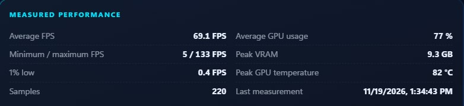
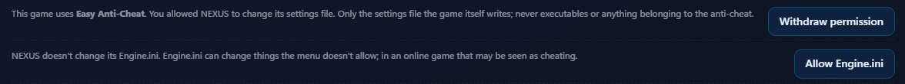
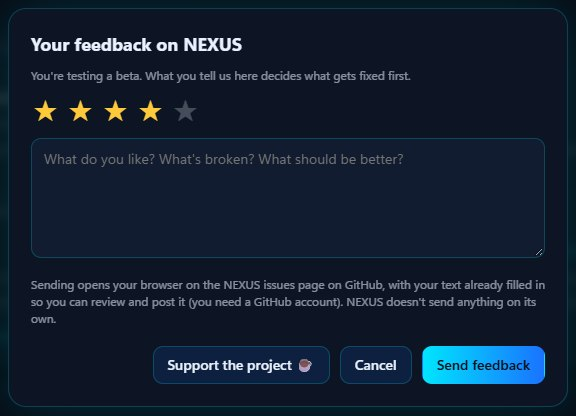

# NEXUS AI Ecosystem — beta

**English** · [Español ↓](#español)

NEXUS is a free Windows app (in beta) that tunes your games' graphics **by measuring, not guessing**. It changes one thing, watches your real FPS while you play, and keeps only what actually helps on your PC.

> **This is a beta.** It has been tested on very few PCs and it may fail. Everything it changes can be undone with one button.

The app is in **English and Spanish**. It uses your Windows language the first time, and you can switch it at any moment from the menu.

## How it works

1. **Press AUTO AI on a game.** NEXUS reads the game's settings files and applies what it can change safely: the game's own settings, the NVIDIA driver profile and the Windows graphics preference. It saves how everything was first.
2. **Play normally, then close the game.** While you play, NEXUS records FPS with [PresentMon](https://github.com/GameTechDev/PresentMon) (Intel's open-source frame counter), plus GPU load, VRAM and temperatures.
3. **NEXUS compares and decides.** After the session it compares FPS before and after. A change that didn't help is removed. If your FPS still don't reach the target, it leaves **one** new option on trial for your next session. You get a Windows notification each time.
4. **Undo at any time.** **Restore everything** puts every setting back the way it was.

It never promises FPS: it tells you what it measured, also when a change did nothing. What it cannot measure is shown as "—".

### Your FPS target

By default AUTO AI aims at your display's refresh rate. You can type your own number for each game (for example 90), or move the slider to **MAX FPS** (keeps looking for more FPS) or **ULTRA QUALITY** (never lowers quality).

## Settings guide (new in 0.35)

Suggested by a Reddit user: like the "optimized settings" guides from hardware channels, but measured on **your** PC.

- First, one reference session with no changes. Then **one setting per session**: shadows, global illumination, reflections, effects, post-processing and draw distance, each one level lower.
- For each setting you see the FPS gained or lost, the 1% low, and a verdict: *clear gain*, *lowers FPS*, *no measurable effect* or *unclear*. If it's unclear, the same test runs one more session.
- Each setting goes back the way it was after it's measured. At the end you tick the ones that are worth it to you, and NEXUS applies only those.

Its limits, plainly: it takes several sessions; it measures normal play, not a repeated benchmark scene, so it is noisier than a benchmark (play in similar areas); and it doesn't judge image quality, which you decide by looking at the game. It passes automated tests but hasn't been tried with real play sessions yet. The screenshot shows it at the start.

## Games with anti-cheat

A common question is whether an anti-cheat will pick NEXUS up.

- NEXUS doesn't inject anything into games, doesn't read or write game memory, and never modifies executables, game data packages or anti-cheat files. FPS come from PresentMon, which reads Windows' own event tracing: no hooks, no overlay.
- When it detects an anti-cheat in a game (Easy Anti-Cheat, BattlEye, NCGuard, nProtect GameGuard, XIGNCODE3, EA Anti-Cheat and others), by default it only changes the NVIDIA driver profile and the Windows graphics preference. Those work outside the game, like the NVIDIA Control Panel.
- For each game you can give it **two separate permissions**, both off by default:
  1. **Its settings file**: the same file the game's own graphics menu writes. It's like changing the menu yourself.
  2. **Engine.ini**: it can change things the menu doesn't offer, like fog. In an online game that may be seen as cheating, so NEXUS shows a warning first and the choice is yours. Withdrawing the permission puts Engine.ini back the way it was.
- Detection looks for the anti-cheat's files in the game folder. An anti-cheat installed only as a system driver can't be seen that way. I can't test every anti-cheat: in competitive online games, leave both permissions off.

## What it does not do

- It does not modify game executables or data packages.
- It does not touch, disable or bypass anti-cheat systems.
- It does not decrypt protected files. If a game encrypts its settings, NEXUS says so and uses other routes.
- It does not make numbers up.

## Also inside

A live PC dashboard (temperatures, load, fans, FPS), your Steam and Epic library, and power controls.

## Requirements

- Windows 11 (64-bit).
- An NVIDIA graphics card to get the most out of it. With AMD or Intel the dashboard and the game-file route work, but they are less tested.
- Games from Steam or Epic. Automatic optimisation is built for Unreal Engine games; with other engines it does less.

## Download

Go to **[Releases](../../releases)** and download the latest `NEXUS-Setup-….exe` (0.35.1).

**Antivirus check:** [VirusTotal scan of NEXUS-Setup-0.35.1.exe](https://www.virustotal.com/gui/file/e4a13612c5f008323304fb575a4d7620f2a15349cec1f6e54a812af40e76f699): 0 of 66 antivirus engines flag it. The installer isn't signed yet, so Windows may still show its "unknown publisher" warning. SHA256: `e4a13612c5f008323304fb575a4d7620f2a15349cec1f6e54a812af40e76f699`

Read the **[installation guide](GUIDE.md)** first. It explains the Windows "unknown publisher" warning and how to undo everything.

## Tested so far

| Game | Result |
|---|---|
| Phantom Blade Zero | Ray tracing turned off from outside the game: from 67 to 81 FPS on average (RTX 3080, 4K), measured and confirmed by the game itself. AUTO AI then tried a lower shadow level, measured no improvement and removed it by itself. |
| SILENT HILL: Townfall | 9 settings applied; measurement pending |
| Halloween: The Game (Easy Anti-Cheat) | Driver and Windows applied, and the settings file with the owner's permission; measurement pending |

These results come from a single PC. The screenshots on this page are real, from that PC. Yours may differ: that is what the beta is for.

## Tell me how it went

The quickest way, **no account needed**: the **[feedback form](https://forms.gle/orRMRurHcRCdbiBRA)**. Stars plus a few optional questions; it takes a minute.

If you have a GitHub account, you can also use the **Feedback & support** button inside NEXUS. It opens a GitHub issue with your text already filled in, and nothing is sent without you. Or open an entry in **[Issues](../../issues)** with:

1. Your graphics card and processor.
2. The game.
3. What NEXUS showed after you played (a screenshot of the "AUTO AI · result" block is enough).
4. What you expected and what happened.

## Coming soon

- **Phone app (iPhone and Android):** see your PC, launch AUTO AI and turn the PC on or off from your phone. It already works in internal testing; there is no release date yet.
- **Signed installer**, so Windows stops showing the "unknown publisher" warning.

No dates are promised: things are released when they have been tested.

## Support the project

NEXUS is free during the beta and is made by one person. If you find it useful, you can support it on **[Ko-fi](https://ko-fi.com/12thmonth)**.

Contributions go to two specific things:

- **The phone app on the App Store.** Publishing there requires a paid Apple developer account every year. It is the app to see your PC, launch AUTO AI and play your games from your phone, also away from home.
- **Signing the Windows installer**, so the "unknown publisher" warning goes away. The certificate is also paid.

Supporting does not unlock anything different and does not buy a date: the beta is the same for everyone.

## Licence

NEXUS is proprietary software. This beta is offered for testing only: see **[LICENSE.md](LICENSE.md)**. It ships with third-party components under their own licences: **[TERCEROS.md](TERCEROS.md)**.

---

# Español

**NEXUS AI Ecosystem — beta** · [English ↑](#nexus-ai-ecosystem--beta)

NEXUS es una aplicación gratuita para Windows (en beta) que ajusta los gráficos de tus juegos **midiendo, no adivinando**. Cambia una cosa, mira tus FPS reales mientras juegas y se queda solo con lo que de verdad ayuda en tu PC.

> **Esto es una beta.** Está probada en muy pocos equipos y puede fallar. Todo lo que cambia se puede deshacer con un botón.

La aplicación está en **español e inglés**. La primera vez usa el idioma de tu Windows, y puedes cambiarlo cuando quieras desde el menú. Las capturas de esta página están en inglés.

## Cómo funciona

1. **Pulsa AUTO AI en un juego.** NEXUS lee los archivos de ajustes del juego y aplica lo que puede cambiar con seguridad: los ajustes del propio juego, el perfil del controlador NVIDIA y la preferencia gráfica de Windows. Antes guarda cómo estaba todo.
2. **Juega normal y cierra el juego.** Mientras juegas, NEXUS graba los FPS con [PresentMon](https://github.com/GameTechDev/PresentMon) (el contador de fotogramas de código abierto de Intel), además del uso de la gráfica, la VRAM y las temperaturas.
3. **NEXUS compara y decide.** Después de la partida compara los FPS de antes y de después. Un cambio que no ayudó se quita. Si tus FPS siguen sin llegar al objetivo, deja **una** opción nueva en prueba para tu próxima partida. Cada vez te avisa con una notificación de Windows.
4. **Deshaz cuando quieras.** **Restaurar todo** devuelve cada ajuste a como estaba.

Nunca promete FPS: te dice lo que midió, también cuando un cambio no sirvió. Lo que no puede medir lo muestra como «—».

### Tu objetivo de FPS

Por defecto AUTO AI apunta a los Hz de tu pantalla. Puedes escribir tu propio número para cada juego (por ejemplo 90), o mover el deslizador a **MAX FPS** (sigue buscando más FPS) o a **ULTRA QUALITY** (nunca baja la calidad).

## Guía de ajustes (nueva en la 0.35)

La propuso un usuario de Reddit: como las guías de «ajustes optimizados» de los canales de pruebas de hardware, pero medida en **tu** PC.

- Primero, una partida de referencia sin cambios. Después, **un ajuste por partida**: sombras, iluminación global, reflejos, efectos, posprocesado y distancia de dibujado, cada uno un nivel más bajo.
- De cada ajuste ves los FPS que gana o pierde, el 1 % más bajo y un veredicto: *mejora clara*, *baja los FPS*, *sin efecto medible* o *dudoso*. Si es dudoso, la misma prueba sigue una partida más.
- Cada ajuste vuelve a como estaba después de medirlo. Al final marcas los que te compensan y NEXUS aplica solo esos.

Sus límites, tal cual: hacen falta varias partidas; mide en partidas normales y no en una escena repetida, así que hay más ruido que en un banco de pruebas (juega en zonas parecidas); y no juzga la calidad de imagen, eso lo decides tú mirando el juego. Pasa las pruebas automáticas, pero todavía no se ha probado con partidas reales. La captura la muestra al empezar.

## Juegos con antitrampas

Una pregunta habitual es si el antitrampas de un juego detectará NEXUS.

- NEXUS no inyecta nada en los juegos, no lee ni escribe su memoria y nunca modifica ejecutables, paquetes de datos ni archivos del antitrampas. Los FPS salen de PresentMon, que lee el registro de eventos del propio Windows: sin ganchos y sin superposiciones.
- Cuando detecta un antitrampas en un juego (Easy Anti-Cheat, BattlEye, NCGuard, nProtect GameGuard, XIGNCODE3, EA Anti-Cheat y otros), por defecto solo cambia el perfil del controlador NVIDIA y la preferencia gráfica de Windows. Eso funciona fuera del juego, como el Panel de control de NVIDIA.
- En cada juego puedes darle **dos permisos separados**, los dos apagados de entrada:
  1. **Su archivo de ajustes**: el mismo que escribe el menú de gráficos del juego. Es como cambiar el menú tú mismo.
  2. **Engine.ini**: puede cambiar cosas que el menú no ofrece, como la niebla. En un juego online eso puede verse como trampa, así que NEXUS avisa antes y la decisión es tuya. Al retirar el permiso, Engine.ini vuelve a como estaba.
- La detección busca los archivos del antitrampas en la carpeta del juego. Un antitrampas instalado solo como controlador del sistema no se ve así. No puedo probar todos los antitrampas: en juegos online competitivos, deja los dos permisos apagados.

## Qué no hace

- No modifica ejecutables ni paquetes de datos de los juegos.
- No toca, desactiva ni evita sistemas antitrampas.
- No descifra archivos protegidos. Si un juego cifra sus ajustes, NEXUS lo dice y usa otros caminos.
- No inventa números.

## Además

Panel del PC en tiempo real (temperaturas, uso, ventiladores, FPS), tu biblioteca de Steam y Epic, y control de energía.

## Requisitos

- Windows 11 (64 bits).
- Tarjeta gráfica NVIDIA para aprovecharlo todo. Con AMD o Intel funcionan el panel y la parte de archivos del juego, pero está menos probado.
- Juegos de Steam o Epic. La optimización automática está pensada para juegos hechos con Unreal Engine; con otros motores hace menos.

## Descargar

Ve a **[Releases](../../releases)** y descarga el último `NEXUS-Setup-….exe` (0.35.1).

**Análisis antivirus:** [análisis de VirusTotal de NEXUS-Setup-0.35.1.exe](https://www.virustotal.com/gui/file/e4a13612c5f008323304fb575a4d7620f2a15349cec1f6e54a812af40e76f699): 0 de 66 antivirus lo marcan. El instalador todavía no está firmado, así que Windows puede mostrar igualmente su aviso de «editor desconocido». SHA256: `e4a13612c5f008323304fb575a4d7620f2a15349cec1f6e54a812af40e76f699`

Lee antes la **[guía de instalación](GUIA.md)**. Explica el aviso de «editor desconocido» de Windows y cómo deshacer todo.

## Probado hasta ahora

| Juego | Resultado |
|---|---|
| Phantom Blade Zero | Trazado de rayos apagado desde fuera del juego: de 67 a 81 FPS de media (RTX 3080, 4K), medido y confirmado por el propio juego. Después AUTO AI probó un nivel de sombras más bajo, midió que no mejoraba y lo quitó sola. |
| SILENT HILL: Townfall | 9 ajustes aplicados; pendiente de medición |
| Halloween: The Game (Easy Anti-Cheat) | Controlador y Windows aplicados, y el archivo de ajustes con permiso del dueño; pendiente de medición |

Son resultados de un solo equipo. Las capturas de esta página son reales, de ese equipo. En el tuyo pueden ser distintos: para eso es la beta.

## Cuéntame cómo te fue

Lo más rápido, **sin cuenta**: el **[formulario de opinión](https://forms.gle/orRMRurHcRCdbiBRA)**. Estrellas y unas preguntas opcionales; es un minuto.

Si tienes cuenta de GitHub, también puedes usar el botón **Opinar y apoyar** dentro de NEXUS. Abre un aviso en GitHub con tu texto ya escrito, y no se envía nada sin ti. O abre un aviso en **[Issues](../../issues)** con:

1. Tu tarjeta gráfica y procesador.
2. El juego.
3. Qué te mostró NEXUS después de jugar (una captura del bloque «AUTO AI · resultado» sirve).
4. Qué esperabas y qué pasó.

## Próximamente

- **App para el teléfono (iPhone y Android):** ver el estado del PC, lanzar AUTO AI y apagar o encender el equipo desde el móvil. Ya funciona en pruebas internas; todavía no hay fecha para publicarla.
- **Instalador firmado**, para que Windows no muestre el aviso de «editor desconocido».

No hay fechas prometidas: se publicará cuando esté probado.

## Apoyar el proyecto

NEXUS es gratis durante la beta y lo hace una sola persona. Si te resulta útil, puedes apoyarlo en **[Ko-fi](https://ko-fi.com/12thmonth)**.

Las aportaciones van a dos cosas concretas:

- **La app del teléfono en la App Store.** Publicar ahí exige una cuenta de desarrollador de Apple, que es de pago cada año. Es la app para ver tu PC, lanzar AUTO AI y jugar a tus juegos desde el móvil, también fuera de casa.
- **Firmar el instalador de Windows**, para que deje de salir el aviso de «editor desconocido». El certificado también es de pago.

Apoyar no da acceso a nada distinto ni compra una fecha: la beta es la misma para todos.

## Licencia

NEXUS es software propietario. Esta beta se ofrece solo para probarla: consulta **[LICENSE.md](LICENSE.md)**. Incluye componentes de terceros con sus propias licencias: **[TERCEROS.md](TERCEROS.md)**.
