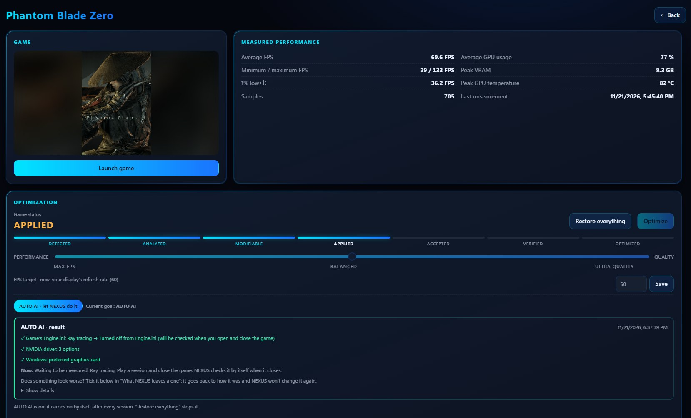
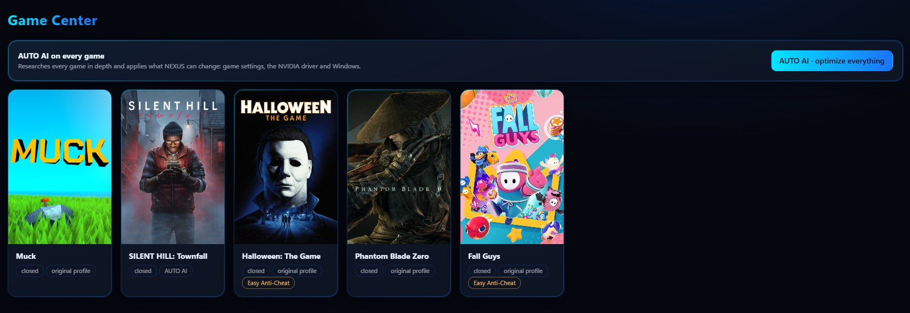
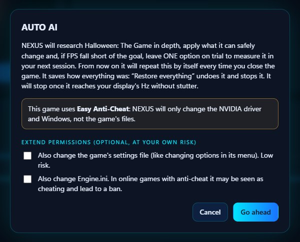
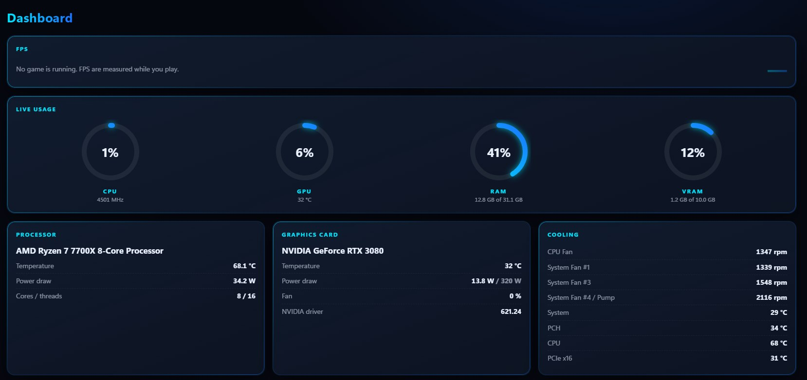

# NEXUS AI Ecosystem — beta

**English** · [Español ↓](#español)

**NEXUS is a free Windows app that tunes each game's graphics by measuring your real FPS while you play: it keeps only the changes that help on your PC, and one button undoes everything.**

> **This is a beta.** It has been tested on very few PCs and it may fail. Everything it changes can be undone with one button.

**Current version: [0.40.0](https://github.com/Haitianleo/nexus-beta/releases/tag/v0.40.0-beta)** · [Download](#download) · [Installation guide](GUIDE.md)

The app is in **English and Spanish**. It uses your Windows language the first time, and you can switch it at any moment from the menu.

## What's new in 0.40

These are the full notes of this version; the app shows a shorter version.

- **More launchers.** Besides Steam and Epic Games, NEXUS now finds your games from **Xbox** (Xbox app, PC Game Pass and Microsoft Store), **GOG**, **EA app**, **Ubisoft Connect**, **Amazon Games** and **Riot Games**, plus the non-Steam games you've added to Steam. Each card shows its launcher and you can filter the list. A game that's in two launchers appears only once.
- **Add a game by hand.** For anything no launcher knows about (Battle.net, emulators, standalone games): the “Add a game” button, pick its .exe and that's it.
- **Anti-cheat known from more sources.** Besides looking in the game's folder, NEXUS knows a game uses anti-cheat from its launcher (Riot games use Vanguard) and from the public Are We Anti-Cheat Yet? list, downloaded at most once a week (nothing is sent). In those games, as always, it only changes the graphics driver and Windows unless you give permission.
- **Nothing is undone on its own.** If NEXUS learns that a game uses anti-cheat after it had already changed something, it leaves it as it is, tells you, and changes nothing else in the game's files without your permission. “Restore everything” still puts it all back.
- **The settings guide also tests the graphics driver and Windows.** After the game's own settings it measures options that don't touch the game's files: on NVIDIA, threaded optimization and an unlimited shader cache; on Intel, low latency; in Windows, optimizations for windowed games and variable refresh rate. So the guide now works in games with anti-cheat too. And when optimizing, NEXUS turns on Windows' optimizations for windowed games.
- **One question, just once.** After your first measured game session, NEXUS asks whether this version works better, the same or worse for you than the last one. Only which button was clicked is counted (anonymously, and only if you have statistics turned on); if you want to say more, the usual feedback form opens and nothing leaves your PC until you send it. You can close it without answering and it won't come back.

**Graphics cards**

- **NVIDIA:** full support.
- **Intel:** temperature, fan and driver settings; new and not yet tested on real Intel cards.
- **AMD:** temperature, fan and power draw; driver settings arrive in a coming version.
- On Intel (Arc and recent integrated graphics) NEXUS changes the driver for each game only (low latency, sync and Endurance Gaming) and puts it back; it never touches Intel's general settings. On AMD the driver settings (Anti-Lag, Chill and others) are prepared but not part of this version; meanwhile NEXUS keeps optimizing game settings and Windows.

**Fixes**

- **Documents in OneDrive.** If Windows keeps your Documents folder in OneDrive (the usual case with its backup turned on), NEXUS now looks there for your games' settings. Before, it couldn't find them or recognize them as yours.
- **The game list loads faster**, and a launcher that fails no longer hides the games from the others.
- **Diagnostics recognize any graphics card** (NVIDIA, AMD or Intel), not just NVIDIA ones, and “Export diagnostics” now includes how NEXUS is getting on with your card's driver.
- NEXUS is better at picking each game's executable, using the one its launcher points to.

**Installer**

- The Beta installer no longer includes the components of the phone features (Sunshine and Tailscale), so it's smaller: 39.7 MB, down from 66.4 MB in 0.39.0. Game Streaming and Remote access still show as “Coming soon”. Updating removes the copies left by the previous version.

**Not tested yet**

- Only Steam and Epic Games have been tried with real games. For Xbox, NEXUS found a real Microsoft Store game on the test PC; launching and measuring a PC Game Pass game hasn't been tried. EA app and Ubisoft Connect are detected, but not tried with a game installed. GOG, Amazon Games, Riot and non-Steam games added to Steam: sample data only.
- “Add a game”, the launcher filter and the new NVIDIA driver and Windows options have only passed automated tests.
- The Intel card support and the AMD readings couldn't be tested on those cards: we don't have any. Before each driver change NEXUS saves how it was and checks it afterwards; if something goes wrong, “Restore everything” undoes it.
- Documents in OneDrive: the folder is found on the test PC; it still has to be tried with a game that keeps its settings there.

**On an AMD or Intel card? We need your help**

- Tell us how it goes with the “Give feedback” button. If something from the untested list fails, tell us too.
- If you can, send the diagnostics as well: “Connection & security” → “Help” → “Export diagnostics” saves a .zip without your user name, your PC's name or full paths. NEXUS never sends it: you attach it yourself to a new issue at github.com/Haitianleo/nexus-beta/issues.
- GitHub Issues are public: whoever attaches the .zip there is publishing it. The file names your games, so have a look inside first.

**Coming soon in 0.41**

Confirmed:

- NEXUS will be able to change the upscaler (DLSS, FSR, XeSS) in more games.
- AUTO AI will pick each change by how many FPS it gives and how visible it is.

Probably:

- PC check: warnings about things that slow games down (memory, driver, overlays).
- More ways to find settings in games that don't use Unreal.
- Battle.net and Rockstar Games Launcher.

NEXUS isn't code-signed: Windows may show SmartScreen (“More info” → “Run anyway”) and the User Account Control prompt with “Unknown publisher”.

## How it works

1. **Press AUTO AI on a game.** NEXUS reads the game's settings files and applies what it can change safely: the game's own settings, the graphics driver and Windows' graphics options for that game. It saves how everything was first.
2. **Play normally, then close the game.** While you play, NEXUS records FPS with [PresentMon](https://github.com/GameTechDev/PresentMon) (Intel's open-source frame counter), plus GPU load, VRAM and temperatures.
3. **NEXUS compares and decides.** After the session it compares FPS before and after. A change that didn't help is removed. If your FPS still don't reach the target, it leaves **one** new option on trial for your next session. When a change measurably raised your FPS, a Windows notification tells you.
4. **Undo at any time.** **Restore everything** puts every setting back the way it was.

It never promises FPS: it tells you what it measured, also when a change did nothing. What it cannot measure is shown as "—".

### Your FPS target

By default AUTO AI aims at your display's refresh rate. You can type your own number for each game (for example 90), or move the slider to **MAX FPS** (keeps looking for more FPS) or **ULTRA QUALITY** (never lowers quality).

## Launchers

NEXUS finds the games from **Steam, Epic Games, Xbox (Xbox app, PC Game Pass and Microsoft Store), GOG, Ubisoft Connect, EA app, Amazon Games and Riot Games**, and the non-Steam games you added to Steam. A game that is in two launchers appears once. NEXUS only reads what each launcher leaves on your PC; it decrypts nothing.

Anything else (Battle.net, emulators, standalone games) can be added by hand: **Add a game** in Game Center, then pick the game's `.exe`. **Remove from NEXUS** takes it off the list again without touching the game.

How far each launcher has been tried is in [Tested and not tested yet](#tested-and-not-tested-yet).

*Captured with 0.39. In 0.40 each card also shows its launcher, and Game Center has the launcher filter and the Add a game button.*

## Graphics cards

- **NVIDIA:** full support.
- **Intel:** temperature, fan and driver settings; new and not yet tested on real Intel cards.
- **AMD:** temperature, fan and power draw; driver settings arrive in a coming version.

The AMD readings are new too and haven't been tried on a real Radeon yet.

NEXUS works with the card you play on: the dedicated one with the most memory. On any card it can change the game's own settings and Windows' graphics options for that game, and it measures FPS the same way.

"Driver settings" are the ones NEXUS changes in the graphics driver for one game only. Before each change it saves how the setting was; afterwards it reads it back and, if the driver didn't take it, undoes it and says so. **Restore everything** puts them back. On Intel (Arc and recent integrated graphics) they are low latency, sync and Endurance Gaming, and NEXUS never touches Intel's general settings. On AMD they (Anti-Lag, Chill and others) are prepared but not part of 0.40.0.

**Have an AMD or Intel card? I need your help.** I don't have one to test with. In NEXUS go to **Connection & security → Help → Export diagnostics** and send me the `.zip`: how to do it is in [Tell me how it went](#tell-me-how-it-went).

## Settings guide

Suggested by a Reddit user: like the "optimized settings" guides from hardware channels, but measured on **your** PC.

- First, one reference session with no changes. Then **one setting per session**: shadows, global illumination, reflections, effects, post-processing and draw distance, each one level lower.
- After those, the guide also tries graphics driver and Windows options that don't touch the game's files: on NVIDIA, threaded optimization and an unlimited shader cache; on Intel, low latency; in Windows, optimizations for windowed games and variable refresh rate. In a game with anti-cheat, unless you gave the extra permissions, these are the only ones it tries.
- For each setting you see the FPS gained or lost, the 1% low, and a verdict: *clear gain*, *lowers FPS*, *no measurable effect* or *unclear*. If it's unclear, the same test runs one more session.
- Each setting goes back the way it was after it's measured. At the end you tick the ones that are worth it to you, and NEXUS applies only those.
- If the game puts its settings file back (some games do), the guide notices on the first test and carries on through Engine.ini, which the game reads at startup. It then also writes the exact variables the game itself uses for that level, read from the game's own configuration inside its packages (only when they aren't encrypted), so the values are the game's own, not made up. The table shows it as "via Engine.ini · N variables from the game".
- **Forget what was learned:** to run the guide again from scratch, this button sets aside what NEXUS checked about that game on your PC. It doesn't change the game or undo anything you applied.

Its limits, plainly: it takes several sessions; it measures normal play, not a repeated benchmark scene, so it is noisier than a benchmark (play in similar areas); and it doesn't judge image quality, which you decide by looking at the game. It passes automated tests, but how accurate it is in real play sessions is still to be seen.

## Keep a setting as it is

Asked on Reddit: "I want ray tracing on and let it tune the rest." Each game has **What NEXUS leaves alone in this game**: one button per kind of setting (ray tracing, shadows, textures…). AUTO AI, Optimize and the settings guide leave those alone. If NEXUS had already changed one, it puts it back, unless you changed it yourself in the game menu afterwards.

When AUTO AI changes something it reminds you right there: if something looks worse (say, blurrier shadows), tick it in **What NEXUS leaves alone** and it goes back.

It passes automated tests but hasn't been tried in real play sessions yet.

## The game's files

- **Engine.ini isn't only NEXUS's.** You can edit it yourself, and some games (Mortal Shell II, for example) save their own options there. When NEXUS undoes a change it removes only its own lines; if nobody else touched the file, it goes back exactly as it was.
- **Settings saved in `.sav` files.** Some Unreal games keep their graphics options in their own save file and ignore their `.ini`. NEXUS writes those too, with a backup, only with the game closed, and checks them after you play. Encrypted or unknown files are marked *Not recognized* and left alone. It never writes saved games.
- **Mod files are read-only.** Whatever sits in a mod folder (Mods, ~mods, UE4SS, ReShade, BepInEx…) is read, never written.
- **25 kinds of settings.** In any game that saves them in readable files, NEXUS tells apart 25 kinds of graphics settings: ray tracing, shadows, textures, frame generation, HDR, low latency, FPS limit and more. Checked against the real settings files of three games.
- **Documents in OneDrive.** If Windows keeps your Documents folder in OneDrive (the usual case with its backup turned on), NEXUS looks there too.

## Games with anti-cheat

A common question is whether an anti-cheat will pick NEXUS up.

- NEXUS doesn't inject anything into games, doesn't read or write game memory, and never modifies executables, game data packages or anti-cheat files. FPS come from PresentMon, which reads Windows' own event tracing: no hooks, no overlay.
- When NEXUS knows a game uses an anti-cheat (Easy Anti-Cheat, BattlEye, Riot Vanguard, NCGuard, nProtect GameGuard, XIGNCODE3, EA Anti-Cheat and others), by default it only changes the graphics driver and Windows for that game. Those work outside the game, like the driver's own control panel.
- When you press AUTO AI on such a game, the window says so and offers **two separate permissions**, both unticked:
  1. **The game's settings file**: the same file the game's own graphics menu writes. It's like changing the menu yourself.
  2. **Engine.ini**: it can change things the menu doesn't offer, like fog. In an online game that may be seen as cheating, so NEXUS asks a second time before allowing it, and the choice is yours.
- **Remove permissions**, on the game's page, takes them back and puts back what was changed with them.
- How NEXUS knows: the anti-cheat's files in the game folder, what the launcher says (Riot games use Vanguard) and the public [Are We Anti-Cheat Yet?](https://areweanticheatyet.com) list, which it downloads at most once a week (nothing is sent). It can still miss one, and I can't test every anti-cheat: in competitive online games, leave both permissions off.
- **Nothing is undone on its own.** If NEXUS learns that a game uses anti-cheat after it had already changed something, it keeps it, tells you, and changes nothing else in the game's files without your permission. **Restore everything** still puts it all back.

*Captured with 0.39; in 0.40 the text says "graphics driver" instead of "NVIDIA driver".*

**Settings saves (`.sav`) count as the game's settings file:** in a game with anti-cheat, NEXUS only writes them with that game's extended permission, never saved games.

**Extended permissions are your responsibility.** NEXUS takes no responsibility for penalties or bans if you turn them on. Removing them puts back what was changed with them.

## What it does not do

- It does not modify game executables or data packages.
- It does not touch, disable or bypass anti-cheat systems.
- It does not decrypt protected files. If a game encrypts its settings, NEXUS says so and uses other routes.
- It does not make numbers up.

## Also inside

- A live PC dashboard (temperatures, load, fans, FPS) and power controls.
- Windows notifications with buttons: new version, newly installed game, dangerous temperature while playing, and AUTO AI only when it really raised your FPS (measured). Each kind can be turned off.

## Updating from the app

Once a day NEXUS checks this page for a newer version. If there is one, it shows the notes and offers **Update now**, **Later** (asks again the next day) or **Skip this version**. *Update now* downloads the installer only from this page's releases and checks its SHA-256 against the published `.sha256` file; if it doesn't match, nothing is installed. Windows asks for administrator permission, NEXUS closes, updates and reopens by itself. You can turn the check off in **Connection & security**.

**Only 0.39 and later update by themselves.** With an older version, download and install 0.40.0 by hand once (0.35.1 and older don't even check for new versions). If you also want an email from GitHub with each new version, click **Watch → Custom → Releases** at the top of this page.

## Privacy

**Anonymous statistics come turned ON.** NEXUS counts how many people use it. On first launch a notice explains it and lets you turn it off right there; afterwards you can change it anytime in **Connection & security → Privacy**. Nothing is sent before you've seen that notice. If you had already said *no* in an earlier version, your choice is kept.

What is sent, while NEXUS is open, every 5 minutes, to NEXUS's own server (Cloudflare):

- a **random number for this installation** (it identifies the install, not you or your PC), the **NEXUS version** and the **edition** (Beta). The server notes the days on which that number was seen, to know how many installs come back;
- **counts** of four things: how many times NEXUS checked for a new version, how many times *Support NEXUS* and the GitHub star were clicked and, since 0.40, how many times each answer (*Better*, *Same* or *Worse*) to the question below was clicked. These counts are stored only as totals per day and version, **without the installation number**.

**The question.** Once per installation, after your first measured game session, NEXUS asks *"Does this version work better for you than the last one?"*. Only the button you click is counted, and only if statistics are on. If you want to say more, **Tell us what failed or what you liked** opens the usual feedback form, and nothing you type leaves your PC until you send that form yourself. You can close the question without answering and it won't come back.

What is **not** sent or stored: your name, email, games, PC details, files, or your IP address. Turning statistics off deletes the random number and nothing else is sent (and nothing is counted).

What else uses the internet:

- The daily check for new versions reads GitHub; it sends nothing about you to GitHub.
- At most once a week NEXUS downloads the public *Are We Anti-Cheat Yet?* list (a file from GitHub); nothing is sent.
- Cover images of Epic games are downloaded once from Epic's own servers.
- Feedback only leaves your PC if you submit the form yourself.
- **Export diagnostics** saves a `.zip` on your PC. NEXUS never sends it: you do, if you want to.

## Requirements

- Windows 11 (64-bit).
- A graphics card from NVIDIA, Intel or AMD. It works best with NVIDIA; AMD and Intel support is new: see [Graphics cards](#graphics-cards).
- Games from the launchers above, or added by hand. Automatic optimisation is built for Unreal Engine games; with other engines it does less.

## Download

Go to **[Releases](https://github.com/Haitianleo/nexus-beta/releases/tag/v0.40.0-beta)** and download `NEXUS-Setup-0.40.0.exe` (0.40.0, 39.7 MB).

**Antivirus check:** [VirusTotal scan of NEXUS-Setup-0.40.0.exe](https://www.virustotal.com/gui/file/640062f1fa19f5837f2cd7eae169169398272e789d58bf67f2670306b85e6603): no antivirus engine flags it (**0/70**). The installer isn't signed yet, so Windows may still show its "unknown publisher" warning. SHA256: `640062f1fa19f5837f2cd7eae169169398272e789d58bf67f2670306b85e6603`

Already have NEXUS? 0.39 offers the update by itself. With an older version, install the new one over it: your settings are kept.

Read the **[installation guide](GUIDE.md)** first. It explains the Windows "unknown publisher" warning and how to undo everything.

## Measured results

| Game | Result |
|---|---|
| Phantom Blade Zero | Ray tracing turned off from outside the game: from 67 to 81 FPS on average (RTX 3080, 4K), measured and confirmed by the game itself. AUTO AI then tried a lower shadow level, measured no improvement and removed it by itself. |

This result comes from a single PC and an earlier version. Yours may differ: that is what the beta is for.

*Captured with an earlier version, which showed the setting's internal name; the beta now shows plain names.*

The screenshots on this page are real, from that PC. Most were taken with 0.39, so a few labels differ in 0.40.

## Tested and not tested yet

What has been tried for real on the test PC (RTX 3080, Windows 11), and what has only passed automated tests with sample data:

| Area | Where it stands |
|---|---|
| Steam and Epic Games | Tried with real games. |
| Xbox, PC Game Pass and Microsoft Store | NEXUS found a real Microsoft Store game on the test PC. Launching and measuring a PC Game Pass game hasn't been tried yet. |
| EA app and Ubisoft Connect | NEXUS detects the launcher on the test PC; not tried with a game installed. |
| GOG, Amazon Games, Riot Games and non-Steam games added to Steam | Sample data only: not tried with the real launcher. |
| Add a game and the launcher filter | Automated tests only: not tried in the real window yet. |
| NVIDIA | Tried on an RTX 3080. The two driver options new in 0.40 (threaded optimization and shader cache) and the new Windows options: automated tests only. |
| Intel: driver settings, temperature and fan | Not tried on a real Intel card. |
| AMD: temperature, fan and power draw | Not tried on a real Radeon. |
| Documents in OneDrive | The folder is found on the test PC; not tried yet with a game that keeps its settings there. |

If any of this fails on your PC, that is exactly what I need to know.

## Tell me how it went

The quickest way, **no account needed**: the **[feedback form](https://forms.gle/orRMRurHcRCdbiBRA)**. Stars plus a few optional questions; it takes a minute.

The **Give feedback** button inside NEXUS opens that same form with your stars and text already filled in: you check it and press Submit. If you have a GitHub account, you can also open an entry in **[Issues](../../issues)** with:

1. Your graphics card and processor.
2. The game and its launcher.
3. What NEXUS showed after you played (a screenshot of the "AUTO AI · result" block is enough).
4. What you expected and what happened.

### AMD or Intel card? Send me the diagnostics

1. Install 0.40.0 and use it as usual: look at the Dashboard (does it show your card's temperature and fan?) and try AUTO AI on a game.
2. In NEXUS go to **Connection & security → Help → Export diagnostics**. It saves a `.zip` with where NEXUS looked for your games' settings, basic PC details (Windows, processor, graphics card, memory) and how it got on with your card's driver. It has no user name, no PC name and no full paths, and NEXUS never sends it.
3. Attach the `.zip` to a new entry in **[Issues](../../issues)** and say which card you have. **GitHub Issues are public: attaching the `.zip` there publishes it.** The file names your games, so have a look inside first. No GitHub account? Tell me your card and what you saw in the [feedback form](https://forms.gle/orRMRurHcRCdbiBRA).

## Coming soon

What's planned for 0.41 is at the end of [What's new in 0.40](#whats-new-in-040).
Later, with no version yet:

- **AMD driver settings.**
- **Game Streaming and Remote access** (play and control your PC from your phone, also away from home), with the **phone app (iPhone and Android)**. In this beta they show as *Coming soon*: NEXUS works on this PC only, doesn't accept outside connections and creates no Windows Firewall rules.
- **Signed installer**, so Windows stops showing the "unknown publisher" warning.

No dates are promised: things are released when they have been tested.

## Support the project

NEXUS is free during the beta and is made by one person. If you find it useful, you can support it on **[Ko-fi](https://ko-fi.com/12thmonth)**.

Contributions go to two specific things:

- **The phone app on the App Store.** Publishing there requires a paid Apple developer account every year. It is the app to see your PC, launch AUTO AI and play your games from your phone, also away from home.
- **Signing the Windows installer**, so the "unknown publisher" warning goes away. The certificate is also paid.

Supporting does not unlock anything different and does not buy a date: the beta is the same for everyone.

## Licence

NEXUS is proprietary software. This beta is offered for testing only: see **[LICENSE.md](LICENSE.md)**. It ships with third-party components under their own licences: **[TERCEROS.md](TERCEROS.md)**.

---

# Español

**NEXUS AI Ecosystem — beta** · [English ↑](#nexus-ai-ecosystem--beta)

**NEXUS es una aplicación gratuita para Windows que ajusta los gráficos de cada juego midiendo tus FPS reales mientras juegas: se queda solo con los cambios que ayudan en tu PC, y un botón lo deshace todo.**

> **Esto es una beta.** Está probada en muy pocos equipos y puede fallar. Todo lo que cambia se puede deshacer con un botón.

**Versión actual: [0.40.0](https://github.com/Haitianleo/nexus-beta/releases/tag/v0.40.0-beta)** · [Descargar](#descargar) · [Guía de instalación](GUIA.md)

La aplicación está en **español e inglés**. La primera vez usa el idioma de tu Windows, y puedes cambiarlo cuando quieras desde el menú. Las capturas de esta página están en inglés.

## Novedades de la 0.40

Estas son las notas completas de esta versión; la app enseña una versión más corta.

- **Más lanzadores.** Además de Steam y Epic Games, NEXUS encuentra ahora tus juegos de **Xbox** (app de Xbox, PC Game Pass y Microsoft Store), **GOG**, **EA app**, **Ubisoft Connect**, **Amazon Games** y **Riot Games**, y los juegos que no son de Steam que hayas añadido a Steam. Cada tarjeta dice de qué lanzador es y puedes filtrar la lista. Si un juego está en dos lanzadores, sale una sola vez.
- **Añadir un juego a mano.** Para lo que ningún lanzador conoce (Battle.net, emuladores, juegos sueltos): botón «Añadir un juego», eliges su .exe y listo.
- **Antitrampas conocidos por más vías.** Además de mirar la carpeta del juego, NEXUS sabe que un juego lleva antitrampas por su lanzador (los de Riot usan Vanguard) y por la lista pública de Are We Anti-Cheat Yet?, que descarga como mucho una vez por semana (no envía nada). En esos juegos, como siempre, solo cambia el controlador de la gráfica y Windows salvo que tú des permiso.
- **Nada se deshace solo.** Si NEXUS se entera de que un juego usa antitrampas cuando ya le había cambiado algo, lo deja como está, te avisa y no cambia nada más en sus archivos sin tu permiso. «Restaurar todo» sigue devolviéndolo todo a como estaba.
- **La guía de ajustes prueba también el controlador de la gráfica y Windows.** Después de los ajustes del juego mide opciones que no tocan sus archivos: en NVIDIA, la optimización multihilo y la caché de sombreadores sin límite; en Intel, la baja latencia; en Windows, las optimizaciones para juegos en ventana y la frecuencia de actualización variable. Así la guía sirve también en juegos con antitrampas. Y al optimizar, NEXUS activa las optimizaciones de Windows para juegos en ventana.
- **Una pregunta, una sola vez.** Después de tu primera partida medida, NEXUS te pregunta si esta versión te funciona mejor, igual o peor que la anterior. Solo se cuenta qué botón se pulsó (de forma anónima, y solo si tienes encendidas las estadísticas); si quieres contar más, se abre el formulario de opinión de siempre y nada sale de tu PC hasta que lo envías. Puedes cerrarla sin responder y no vuelve a salir.

**Tarjetas gráficas**

- **NVIDIA:** soporte completo.
- **Intel:** temperatura, ventilador y ajustes del controlador, nuevo y sin probar todavía en gráficas Intel reales.
- **AMD:** temperatura, ventilador y consumo; los ajustes del controlador llegan en una próxima versión.
- En Intel (Arc y gráficas integradas recientes) NEXUS cambia el controlador solo para cada juego (baja latencia, sincronización y Endurance Gaming) y lo devuelve a como estaba; nunca toca los ajustes generales de Intel. En AMD los ajustes del controlador (Anti-Lag, Chill y otros) están preparados, pero no van en esta versión; mientras tanto NEXUS sigue optimizando los ajustes del juego y Windows.

**Arreglos**

- **Documentos en OneDrive.** Si Windows tiene tu carpeta Documentos en OneDrive (lo normal con su copia de seguridad activada), NEXUS ya busca ahí los ajustes de tus juegos. Antes no los encontraba ni los reconocía como tuyos.
- **La lista de juegos carga más rápido** y un lanzador que falle ya no esconde los juegos de los demás.
- **El diagnóstico reconoce cualquier tarjeta gráfica** (NVIDIA, AMD o Intel), no solo las NVIDIA, y «Exportar diagnóstico» incluye ahora cómo le va a NEXUS con el controlador de tu gráfica.
- NEXUS acierta mejor con el ejecutable de cada juego, usando el que indica su lanzador.

**Instalador**

- El instalador de la Beta ya no incluye los componentes de las funciones del teléfono (Sunshine y Tailscale), así que pesa menos: 39,7 MB frente a los 66,4 MB de la 0.39.0. Game Streaming y Acceso remoto siguen como «Próximamente». Al actualizar se quitan las copias que dejó la versión anterior.

**Sin probar todavía**

- Solo Steam y Epic Games están probados con juegos reales. De Xbox, NEXUS encontró un juego real de Microsoft Store en el PC de pruebas; abrir y medir un juego de PC Game Pass está sin probar. EA app y Ubisoft Connect se detectan, pero sin probar con un juego instalado. GOG, Amazon Games, Riot y los juegos añadidos a Steam, solo con datos de ejemplo.
- «Añadir un juego», el filtro por lanzador y lo nuevo del controlador NVIDIA y de Windows solo han pasado pruebas automáticas.
- Lo de las tarjetas Intel y los datos de las AMD no se ha podido probar en esas tarjetas: no tenemos ninguna. Antes de cada cambio en el controlador NEXUS guarda cómo estaba y después lo comprueba; si algo no va, «Restaurar todo» lo deshace.
- Documentos en OneDrive: la carpeta se encuentra en el PC de pruebas; falta probarlo con un juego que guarde ahí sus ajustes.

**¿Tienes una gráfica AMD o Intel? Necesitamos tu ayuda**

- Cuéntanos cómo te va con el botón «Dar mi opinión». Si falla algo de lo que está sin probar, también.
- Si puedes, manda además el diagnóstico: «Conexión y seguridad» → «Ayuda» → «Exportar diagnóstico» guarda un .zip sin tu nombre de usuario, sin el nombre del PC y sin rutas completas. NEXUS nunca lo envía: lo adjuntas tú a un aviso nuevo en github.com/Haitianleo/nexus-beta/issues.
- Los Issues de GitHub son públicos: quien adjunta ahí el .zip lo está publicando. El archivo nombra tus juegos, así que míralo antes.

**Próximamente en la 0.41**

Confirmado:

- NEXUS podrá cambiar el escalador (DLSS, FSR, XeSS) en más juegos.
- AUTO AI elegirá cada cambio por cuántos FPS da y cuánto se nota en pantalla.

Probablemente:

- Revisión del PC: avisos de cosas que frenan los juegos (memoria, controlador, superposiciones).
- Más formas de encontrar los ajustes de juegos que no son de Unreal.
- Battle.net y Rockstar Games Launcher.

NEXUS no está firmado: Windows puede mostrar SmartScreen («Más información» → «Ejecutar de todas formas») y el aviso de Control de cuentas con «Editor desconocido».

## Cómo funciona

1. **Pulsa AUTO AI en un juego.** NEXUS lee los archivos de ajustes del juego y aplica lo que puede cambiar con seguridad: los ajustes del propio juego, el controlador de la gráfica y las opciones gráficas de Windows para ese juego. Antes guarda cómo estaba todo.
2. **Juega normal y cierra el juego.** Mientras juegas, NEXUS graba los FPS con [PresentMon](https://github.com/GameTechDev/PresentMon) (el contador de fotogramas de código abierto de Intel), además del uso de la gráfica, la VRAM y las temperaturas.
3. **NEXUS compara y decide.** Después de la partida compara los FPS de antes y de después. Un cambio que no ayudó se quita. Si tus FPS siguen sin llegar al objetivo, deja **una** opción nueva en prueba para tu próxima partida. Cuando un cambio sube de verdad tus FPS (medido), te avisa con una notificación de Windows.
4. **Deshaz cuando quieras.** **Restaurar todo** devuelve cada ajuste a como estaba.

Nunca promete FPS: te dice lo que midió, también cuando un cambio no sirvió. Lo que no puede medir lo muestra como «—».

### Tu objetivo de FPS

Por defecto AUTO AI apunta a los Hz de tu pantalla. Puedes escribir tu propio número para cada juego (por ejemplo 90), o mover el deslizador a **MAX FPS** (sigue buscando más FPS) o a **ULTRA QUALITY** (nunca baja la calidad).

## Lanzadores

NEXUS encuentra los juegos de **Steam, Epic Games, Xbox (app de Xbox, PC Game Pass y Microsoft Store), GOG, Ubisoft Connect, EA app, Amazon Games y Riot Games**, y los juegos que no son de Steam que hayas añadido a Steam. Si un juego está en dos lanzadores, sale una sola vez. NEXUS solo lee lo que cada lanzador deja en tu PC; no descifra nada.

Lo demás (Battle.net, emuladores, juegos sueltos) se añade a mano: **Añadir un juego** en Game Center y eliges el `.exe` del juego. **Quitar de NEXUS** lo saca otra vez de la lista sin tocar el juego.

Hasta dónde se ha probado cada lanzador está en [Probado y sin probar todavía](#probado-y-sin-probar-todavía).

*Captura de la 0.39. En la 0.40 cada tarjeta dice además de qué lanzador es, y Game Center tiene el filtro por lanzador y el botón Añadir un juego.*

## Tarjetas gráficas

- **NVIDIA:** soporte completo.
- **Intel:** temperatura, ventilador y ajustes del controlador, nuevo y sin probar todavía en gráficas Intel reales.
- **AMD:** temperatura, ventilador y consumo; los ajustes del controlador llegan en una próxima versión.

Los datos de las AMD también son nuevos y todavía no se han probado en una Radeon de verdad.

NEXUS usa la tarjeta con la que juegas: la dedicada con más memoria. Con cualquier tarjeta puede cambiar los ajustes del propio juego y las opciones gráficas de Windows para ese juego, y mide los FPS igual.

Los «ajustes del controlador» son los que NEXUS cambia en el controlador de la gráfica solo para un juego. Antes de cada cambio guarda cómo estaba el ajuste; después lo relee y, si el controlador no lo aceptó, lo deshace y lo dice. **Restaurar todo** los devuelve a como estaban. En Intel (Arc y gráficas integradas recientes) son la baja latencia, la sincronización y Endurance Gaming, y NEXUS nunca toca los ajustes generales de Intel. En AMD están preparados (Anti-Lag, Chill y otros), pero no van en la 0.40.0.

**¿Tienes una gráfica AMD o Intel? Necesito tu ayuda.** No tengo ninguna para probar. En NEXUS ve a **Conexión y seguridad → Ayuda → Exportar diagnóstico** y mándame el `.zip`: cómo hacerlo está en [Cuéntame cómo te fue](#cuéntame-cómo-te-fue).

## Guía de ajustes

La propuso un usuario de Reddit: como las guías de «ajustes optimizados» de los canales de pruebas de hardware, pero medida en **tu** PC.

- Primero, una partida de referencia sin cambios. Después, **un ajuste por partida**: sombras, iluminación global, reflejos, efectos, posprocesado y distancia de dibujado, cada uno un nivel más bajo.
- Después de esos, la guía prueba también opciones del controlador de la gráfica y de Windows que no tocan los archivos del juego: en NVIDIA, la optimización multihilo y la caché de sombreadores sin límite; en Intel, la baja latencia; en Windows, las optimizaciones para juegos en ventana y la frecuencia de actualización variable. En un juego con antitrampas, salvo que hayas dado los permisos ampliados, solo prueba estas.
- De cada ajuste ves los FPS que gana o pierde, el 1 % más bajo y un veredicto: *mejora clara*, *baja los FPS*, *sin efecto medible* o *dudoso*. Si es dudoso, la misma prueba sigue una partida más.
- Cada ajuste vuelve a como estaba después de medirlo. Al final marcas los que te compensan y NEXUS aplica solo esos.
- Si el juego devuelve su archivo de ajustes a su valor (algunos lo hacen), la guía lo nota en la primera prueba y sigue por Engine.ini, que el juego lee al arrancar. Entonces escribe además las variables exactas con las que el propio juego define ese nivel, leídas de la configuración que el juego trae dentro de sus paquetes (solo si no están cifrados), así que los valores son los del juego, no inventados. En la tabla sale como «por Engine.ini · N variables del juego».
- **Olvidar lo aprendido:** para repetir la guía desde cero, este botón aparta lo que NEXUS comprobó de ese juego en tu PC. No cambia nada del juego ni deshace lo que aplicaste.

Sus límites, tal cual: hacen falta varias partidas; mide en partidas normales y no en una escena repetida, así que hay más ruido que en un banco de pruebas (juega en zonas parecidas); y no juzga la calidad de imagen, eso lo decides tú mirando el juego. Pasa las pruebas automáticas, pero su precisión en partidas reales está por ver.

## Dejar un ajuste como está

Lo pidieron en Reddit: «quiero el trazado de rayos encendido y que ajuste el resto». Cada juego tiene **Lo que NEXUS no toca en este juego**: un botón por tipo de ajuste (trazado de rayos, sombras, texturas…). AUTO AI, Optimizar y la guía de ajustes no los tocan. Si NEXUS ya había cambiado alguno, lo devuelve a como estaba, salvo que lo hayas cambiado tú después en el menú del juego.

Cuando AUTO AI cambia algo te lo recuerda ahí mismo: si algo se ve peor (por ejemplo, sombras más borrosas), márcalo en **Lo que NEXUS no toca** y vuelve a como estaba.

Pasa las pruebas automáticas, pero todavía no se ha probado con partidas reales.

## Los archivos del juego

- **Engine.ini no es solo de NEXUS.** Puedes editarlo tú, y algunos juegos (por ejemplo Mortal Shell II) guardan ahí sus propias opciones. Al deshacer un cambio, NEXUS quita solo sus propias líneas; si nadie más tocó el archivo, vuelve exactamente a como estaba.
- **Ajustes guardados en `.sav`.** Algunos juegos de Unreal guardan sus opciones gráficas en un archivo propio e ignoran su `.ini`. NEXUS también los escribe ahí, con copia, solo con el juego cerrado, y lo comprueba después de jugar. Lo cifrado o desconocido sale como *No reconocido* y no se toca. Nunca escribe las partidas guardadas.
- **Los archivos de mods son de solo lectura.** Lo que está en una carpeta de mod (Mods, ~mods, UE4SS, ReShade, BepInEx…) se lee, nunca se escribe.
- **25 tipos de ajustes.** En cualquier juego que los guarde en archivos legibles, NEXUS distingue 25 tipos de ajustes gráficos: trazado de rayos, sombras, texturas, generación de fotogramas, HDR, baja latencia, límite de FPS y más. Comprobado con los archivos de ajustes reales de tres juegos.
- **Documentos en OneDrive.** Si Windows tiene tu carpeta Documentos en OneDrive (lo normal con su copia de seguridad activada), NEXUS busca también ahí.

## Juegos con antitrampas

Una pregunta habitual es si el antitrampas de un juego detectará NEXUS.

- NEXUS no inyecta nada en los juegos, no lee ni escribe su memoria y nunca modifica ejecutables, paquetes de datos ni archivos del antitrampas. Los FPS salen de PresentMon, que lee el registro de eventos del propio Windows: sin ganchos y sin superposiciones.
- Cuando NEXUS sabe que un juego usa antitrampas (Easy Anti-Cheat, BattlEye, Riot Vanguard, NCGuard, nProtect GameGuard, XIGNCODE3, EA Anti-Cheat y otros), por defecto solo cambia el controlador de la gráfica y Windows para ese juego. Eso funciona fuera del juego, como el panel de control del propio controlador.
- Al pulsar AUTO AI en uno de esos juegos, la ventana lo dice y ofrece **dos permisos separados**, los dos sin marcar:
  1. **El archivo de ajustes del juego**: el mismo que escribe el menú de gráficos del juego. Es como cambiar el menú tú mismo.
  2. **Engine.ini**: puede cambiar cosas que el menú no ofrece, como la niebla. En un juego online eso puede verse como trampa, así que NEXUS pregunta una segunda vez antes de permitirlo, y la decisión es tuya.
- **Quitar permisos**, en la ficha del juego, los retira y devuelve a como estaba lo que se cambió con ellos.
- Cómo lo sabe NEXUS: por los archivos del antitrampas en la carpeta del juego, por lo que dice su lanzador (los juegos de Riot usan Vanguard) y por la lista pública de [Are We Anti-Cheat Yet?](https://areweanticheatyet.com), que descarga como mucho una vez por semana (no envía nada). Aun así se le puede escapar alguno, y no puedo probar todos los antitrampas: en juegos online competitivos, deja los dos permisos sin marcar.
- **Nada se deshace solo.** Si NEXUS se entera de que un juego usa antitrampas cuando ya le había cambiado algo, lo conserva, te avisa y no cambia nada más en los archivos del juego sin tu permiso. **Restaurar todo** sigue devolviéndolo todo a como estaba.

*Captura de la 0.39; en la 0.40 el texto dice «controlador de la gráfica» en vez de «controlador NVIDIA».*

**Los guardados de ajustes (`.sav`) cuentan como archivo de ajustes del juego:** en un juego con antitrampas, NEXUS solo los escribe con el permiso ampliado de ese juego, y nunca las partidas.

**Los permisos ampliados son responsabilidad tuya.** NEXUS no se hace responsable de sanciones ni baneos si los activas. Al quitarlos, vuelve a como estaba lo que se cambió con ellos.

## Qué no hace

- No modifica ejecutables ni paquetes de datos de los juegos.
- No toca, desactiva ni evita sistemas antitrampas.
- No descifra archivos protegidos. Si un juego cifra sus ajustes, NEXUS lo dice y usa otros caminos.
- No inventa números.

## Además

- Panel del PC en tiempo real (temperaturas, uso, ventiladores, FPS) y control de energía.
- Avisos de Windows con botones: versión nueva, juego nuevo instalado, temperatura peligrosa al jugar y AUTO AI solo cuando de verdad subió tus FPS (medido). Cada tipo se puede apagar.

## Actualizar desde la app

Una vez al día NEXUS mira en esta página si hay una versión más nueva. Si la hay, enseña sus notas y ofrece **Actualizar ahora**, **Más tarde** (vuelve a avisar al día siguiente) o **Saltar esta versión**. *Actualizar ahora* descarga el instalador solo de las publicaciones de esta página y comprueba su SHA-256 con el archivo `.sha256` publicado; si no coincide, no se instala nada. Windows pide permiso de administrador, NEXUS se cierra, se actualiza y se vuelve a abrir sola. Se puede apagar en **Conexión y seguridad**.

**Solo la 0.39 y las posteriores se actualizan solas.** Con una versión anterior, descarga e instala la 0.40.0 a mano una vez (la 0.35.1 y las anteriores ni siquiera buscan versiones nuevas). Si además quieres un correo de GitHub con cada versión nueva, pulsa **Watch → Custom → Releases** arriba en esta página.

## Privacidad

**Las estadísticas anónimas vienen ENCENDIDAS.** NEXUS cuenta cuántas personas lo usan. En el primer arranque un aviso lo explica y permite apagarlo ahí mismo; después se cambia cuando quieras en **Conexión y seguridad → Privacidad**. No se envía nada antes de que hayas visto ese aviso. Si en una versión anterior ya dijiste que *no*, se respeta tu elección.

Qué se envía, mientras NEXUS está abierto, cada 5 minutos, al servidor propio de NEXUS (Cloudflare):

- un **número al azar de esta instalación** (identifica la instalación, no a ti ni a tu PC), la **versión de NEXUS** y la **edición** (Beta). El servidor anota los días en que se vio ese número, para saber cuántas instalaciones vuelven;
- **recuentos** de cuatro cosas: cuántas veces NEXUS buscó una versión nueva, cuántas se pulsaron *Apoyar NEXUS* y la estrella de GitHub y, desde la 0.40, cuántas veces se pulsó cada respuesta (*Mejor*, *Igual* o *Peor*) a la pregunta de abajo. Estos recuentos se guardan solo como totales por día y versión, **sin el número de la instalación**.

**La pregunta.** Una sola vez por instalación, después de tu primera partida medida, NEXUS pregunta *«¿Esta versión te funciona mejor que la anterior?»*. Solo se cuenta qué botón pulsas, y solo si las estadísticas están encendidas. Si quieres contar más, **Contar qué falló o qué te gustó** abre el formulario de opinión de siempre, y nada de lo que escribas sale de tu PC hasta que envíes tú ese formulario. Puedes cerrar la pregunta sin responder y no vuelve a salir.

Qué **no** se envía ni se guarda: tu nombre, correo, juegos, datos del PC, archivos ni tu dirección IP. Al apagar las estadísticas se borra el número al azar y no se envía nada más (ni se cuenta nada).

Qué más usa internet:

- La consulta diaria de versiones nuevas lee GitHub; no le envía nada tuyo.
- Como mucho una vez por semana NEXUS descarga la lista pública de *Are We Anti-Cheat Yet?* (un archivo de GitHub); no envía nada.
- Las portadas de los juegos de Epic se descargan una vez de los servidores de Epic.
- Tu opinión solo sale de tu PC si tú envías el formulario.
- **Exportar diagnóstico** guarda un `.zip` en tu PC. NEXUS nunca lo envía: lo mandas tú, si quieres.

## Requisitos

- Windows 11 (64 bits).
- Una tarjeta gráfica NVIDIA, Intel o AMD. Funciona mejor con NVIDIA; el soporte de AMD e Intel es nuevo: ver [Tarjetas gráficas](#tarjetas-gráficas).
- Juegos de los lanzadores de arriba, o añadidos a mano. La optimización automática está pensada para juegos hechos con Unreal Engine; con otros motores hace menos.

## Descargar

Ve a **[Releases](https://github.com/Haitianleo/nexus-beta/releases/tag/v0.40.0-beta)** y descarga `NEXUS-Setup-0.40.0.exe` (0.40.0, 39,7 MB).

**Análisis antivirus:** [análisis de VirusTotal de NEXUS-Setup-0.40.0.exe](https://www.virustotal.com/gui/file/640062f1fa19f5837f2cd7eae169169398272e789d58bf67f2670306b85e6603): ningún antivirus lo marca (**0/70**). El instalador todavía no está firmado, así que Windows puede mostrar igualmente su aviso de «editor desconocido». SHA256: `640062f1fa19f5837f2cd7eae169169398272e789d58bf67f2670306b85e6603`

¿Ya tienes NEXUS? La 0.39 te ofrece la actualización ella sola. Con una versión anterior, instala la nueva encima: tus ajustes se conservan.

Lee antes la **[guía de instalación](GUIA.md)**. Explica el aviso de «editor desconocido» de Windows y cómo deshacer todo.

## Resultados medidos

| Juego | Resultado |
|---|---|
| Phantom Blade Zero | Trazado de rayos apagado desde fuera del juego: de 67 a 81 FPS de media (RTX 3080, 4K), medido y confirmado por el propio juego. Después AUTO AI probó un nivel de sombras más bajo, midió que no mejoraba y lo quitó sola. |

Es el resultado de un solo equipo y de una versión anterior. En el tuyo puede ser distinto: para eso es la beta.

*Captura de una versión anterior, que enseñaba el nombre interno del ajuste; la beta enseña ahora nombres sencillos.*

Las capturas de esta página son reales, de ese equipo. La mayoría son de la 0.39, así que algún texto cambia en la 0.40.

## Probado y sin probar todavía

Qué se ha probado de verdad en el PC de pruebas (RTX 3080, Windows 11) y qué solo ha pasado pruebas automáticas con datos de ejemplo:

| Parte | Cómo está |
|---|---|
| Steam y Epic Games | Probados con juegos reales. |
| Xbox, PC Game Pass y Microsoft Store | NEXUS encontró un juego real de Microsoft Store en el PC de pruebas. Abrir y medir un juego de PC Game Pass todavía no se ha probado. |
| EA app y Ubisoft Connect | NEXUS detecta el lanzador en el PC de pruebas; sin probar con un juego instalado. |
| GOG, Amazon Games, Riot Games y juegos que no son de Steam añadidos a Steam | Solo datos de ejemplo: sin probar con el lanzador real. |
| Añadir un juego y el filtro por lanzador | Solo pruebas automáticas: sin probar todavía en la ventana real. |
| NVIDIA | Probada en una RTX 3080. Las dos opciones del controlador nuevas en la 0.40 (optimización multihilo y caché de sombreadores) y las opciones nuevas de Windows: solo pruebas automáticas. |
| Intel: ajustes del controlador, temperatura y ventilador | Sin probar en una gráfica Intel de verdad. |
| AMD: temperatura, ventilador y consumo | Sin probar en una Radeon de verdad. |
| Documentos en OneDrive | La carpeta se encuentra en el PC de pruebas; sin probar todavía con un juego que guarde ahí sus ajustes. |

Si algo de esto falla en tu PC, es justo lo que necesito saber.

## Cuéntame cómo te fue

Lo más rápido, **sin cuenta**: el **[formulario de opinión](https://forms.gle/orRMRurHcRCdbiBRA)**. Estrellas y unas preguntas opcionales; es un minuto.

El botón **Dar mi opinión** dentro de NEXUS abre ese mismo formulario con tus estrellas y tu texto ya escritos: lo revisas y pulsas Enviar. Si tienes cuenta de GitHub, también puedes abrir un aviso en **[Issues](../../issues)** con:

1. Tu tarjeta gráfica y procesador.
2. El juego y su lanzador.
3. Qué te mostró NEXUS después de jugar (una captura del bloque «AUTO AI · resultado» sirve).
4. Qué esperabas y qué pasó.

### ¿Gráfica AMD o Intel? Mándame el diagnóstico

1. Instala la 0.40.0 y úsala como siempre: mira el Panel (¿sale la temperatura y el ventilador de tu tarjeta?) y prueba AUTO AI en un juego.
2. En NEXUS ve a **Conexión y seguridad → Ayuda → Exportar diagnóstico**. Guarda un `.zip` con dónde buscó NEXUS los ajustes de tus juegos, los datos básicos del PC (Windows, procesador, tarjeta gráfica, memoria) y cómo le fue con el controlador de tu tarjeta. No lleva tu nombre de usuario, ni el del PC, ni rutas completas, y NEXUS nunca lo envía.
3. Adjunta el `.zip` a un aviso nuevo en **[Issues](../../issues)** y di qué tarjeta tienes. **Los Issues de GitHub son públicos: al adjuntar ahí el `.zip` lo estás publicando.** El archivo nombra tus juegos, así que míralo antes. ¿Sin cuenta de GitHub? Cuéntame tu tarjeta y lo que viste en el [formulario de opinión](https://forms.gle/orRMRurHcRCdbiBRA).

## Próximamente

Lo previsto para la 0.41 está al final de [Novedades de la 0.40](#novedades-de-la-040).
Más adelante, sin versión todavía:

- **Ajustes del controlador de AMD.**
- **Game Streaming y Acceso remoto** (jugar y manejar tu PC desde el teléfono, también fuera de casa), con la **app para el teléfono (iPhone y Android)**. En esta beta salen como *Próximamente*: NEXUS funciona solo en este PC, no acepta conexiones de fuera y no crea reglas en el firewall de Windows.
- **Instalador firmado**, para que Windows no muestre el aviso de «editor desconocido».

No hay fechas prometidas: se publicará cuando esté probado.

## Apoyar el proyecto

NEXUS es gratis durante la beta y lo hace una sola persona. Si te resulta útil, puedes apoyarlo en **[Ko-fi](https://ko-fi.com/12thmonth)**.

Las aportaciones van a dos cosas concretas:

- **La app del teléfono en la App Store.** Publicar ahí exige una cuenta de desarrollador de Apple, que es de pago cada año. Es la app para ver tu PC, lanzar AUTO AI y jugar a tus juegos desde el móvil, también fuera de casa.
- **Firmar el instalador de Windows**, para que deje de salir el aviso de «editor desconocido». El certificado también es de pago.

Apoyar no da acceso a nada distinto ni compra una fecha: la beta es la misma para todos.

## Licencia

NEXUS es software propietario. Esta beta se ofrece solo para probarla: consulta **[LICENSE.md](LICENSE.md)**. Incluye componentes de terceros con sus propias licencias: **[TERCEROS.md](TERCEROS.md)**.
